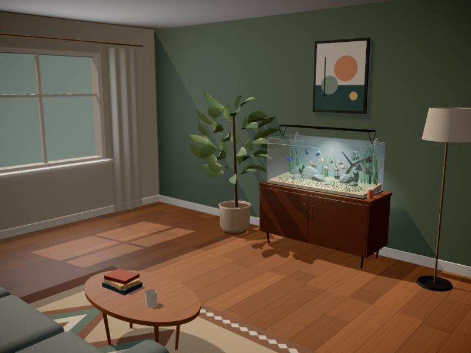

# Vibe Aquarium Sim

A cozy living-room aquarium you can sit and watch. A planted, rimless tank sits on a walnut
sideboard. The room follows your local time: sunlight crosses the floor through the window, the
lamp comes on in the evening, and the tank light dims to moonlight at night. A school of
clownfish, blue tangs and angelfish swims inside.

Fish models were generated with experimental Copilot 3D
(https://copilot.microsoft.com/labs/experiments/3d-generations). Everything else is procedural:
no textures or room models are downloaded.

Live demo: [deadronos.github.io/vibe-aquarium-sim](https://deadronos.github.io/vibe-aquarium-sim/)



## What you can do

- **Watch**: switch between Sofa, Tank, Up close, Room and Follow a fish (keys 1–5).
- **Feed**: click the water, press F, or use Feed. Hungry fish dart for the flakes.
- **Time**: follow your local clock, run a six-minute day cycle, or drag the slider.
- **Listen**: turn on the procedural filter hum and bubbles (M).
- **Hide the UI**: it fades on its own when you stop moving the mouse, or press H.

## How it works

- `src/sim/`: plain TypeScript boids school, food and time-of-day lighting model, unit-tested.
- `src/scene/`: React Three Fiber room, furniture, tank and instanced fish. Under-water
  materials get depth absorption and caustics from a shared shader patch.
- See [AGENTS.md](./AGENTS.md) and [docs/agents](./docs/agents) for the details.

Tech stack: React 19, TypeScript, Vite, Three.js, @react-three/fiber, drei, postprocessing,
zustand.

Getting started

Prerequisites

- Node.js 20+ (this project uses modern toolchains)

Install

```bash
npm ci
```

Run locally

```bash
npm run dev
```

Build

```bash
npm run build
```

Preview production build

```bash
npm run preview
```

Tests & formatting

```bash
npm run test        # run tests
npm run lint        # ESLint
npm run format      # Prettier
```

Development notes

- Avoid allocating Vector3/Matrix objects inside render loops; reuse module-level scratch objects.
- Keep simulation logic in `src/sim/` (no Three.js); the scene reads it each frame.
- Start with `src/config/scene.ts` (dimensions), `src/sim/school.ts` (fish behaviour) and
  `src/scene/Experience.tsx` (scene composition).

GitHub Actions / Deployment

- Pages workflow: `.github/workflows/deploy-pages.yml` builds the app and deploys the `dist/` output to GitHub Pages using current action versions (checkout@v6, setup-node@v6, upload-pages-artifact@v4, deploy-pages@v4).
- Vite `base`: this repo is configured for the project Pages URL `https://deadronos.github.io/vibe-aquarium-sim/` — `base` is set to `/vibe-aquarium-sim/` in `vite.config.ts` and CI passes `--base /vibe-aquarium-sim/` when building.

Contributing

- Read .github/instructions/\* and memory/ to get the project's conventions and design history.
- Keep changes small, test-driven and avoid allocations in render loops.

License & attribution

- Check the repository root for license and contributor information.

Questions / next steps

- Want a PR preview workflow (deploy a preview for PRs) or CI optimization (caching and faster builds)? Open an issue or start a draft PR.
